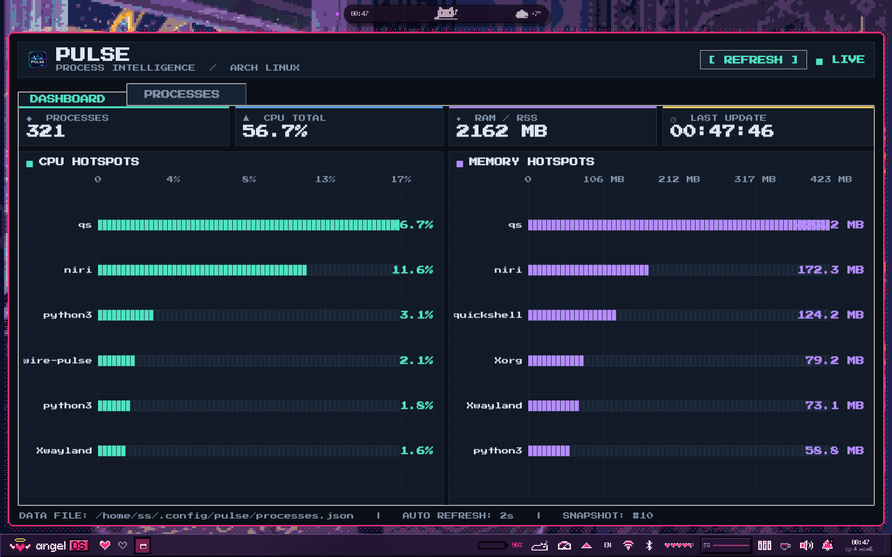

<div align="center">


# 🚀 PULSE System Monitor

### Неоновый пиксельный системный монитор для Arch Linux

[](https://archlinux.org)
[](https://python.org)
[](LICENSE)

</div>

---

## ✨ О проекте

**PULSE** — лёгкий и стильный монитор процессов для Arch Linux и производных (Garuda, CachyOS, Manjaro, EndeavourOS).

- 🎨 Неоновый cyberpunk UI
- ⚡ Обновление каждые 2 секунды
- 📊 Графики CPU и RAM в реальном времени
- 🧵 Многопоточный — UI не зависает
- 📦 Нативная сборка через PKGBUILD

---

## 📸 Скриншот

### 🖥️ Dashboard


---

## 🚀 Установка

### Шаг 1: Клонируем репозиторий

```bash
git clone https://github.com/sendox2012-debug/pulse-app
cd pulse-app
```

### Шаг 2: Устанавливаем зависимости

```bash
sudo pacman -S --needed base-devel python python-pillow tk
```

> **Примечание:** `ttf-press-start-2p` — опционально для пиксельного шрифта.

### Шаг 3: Собираем и устанавливаем

**Вариант A — через `install.sh` (проще):**

```bash
chmod +x install.sh
./install.sh
```

Скрипт сам проверит зависимости, соберёт пакет и установит его.

**Вариант B — вручную через `makepkg`:**

```bash
makepkg -si
```

`makepkg -si` = собрать + установить зависимости + установить пакет.

---

## 🎮 Использование

### Запуск:
```bash
pulse
```

Или найди **PULSE System Monitor** в меню приложений.

### Управление:
- **[ REFRESH ]** — мгновенное обновление
- **Вкладки:** `DASHBOARD` / `PROCESSES`

---

## 🔧 Управление

### Переустановка:
```bash
./install.sh --uninstall
./install.sh
```

---

## 🐛 Решение проблем

### Иконка не появляется в меню
```bash
sudo update-desktop-database /usr/share/applications
sudo gtk-update-icon-cache -f /usr/share/icons/hicolor
```

Для KDE:
```bash
kbuildsycoca6 --noincremental
```

### Ошибка `from: command not found`
Файл `/usr/bin/pulse` потерял shebang. Исправь:
```bash
sudo sed -i '1i#!/usr/bin/env python3' /usr/bin/pulse
sudo chmod +x /usr/bin/pulse
```

### Проверка зависимостей Python
```bash
python3 -c "import tkinter, PIL; print('OK')"
```

---

## 📁 Структура проекта

```
pulse-app/
├── README.md           # Этот файл
├── LICENSE             # MIT
├── PKGBUILD            # Скрипт сборки
├── install.sh          # Автоустановщик
├── pulse.py            # Код приложения
├── pulse.png           # Иконка
├── pulse.desktop       # Desktop entry
└── assets.png          # Скриншот dashboard
```

### После установки:
```
/usr/bin/pulse                              # Исполняемый файл
/usr/share/applications/pulse.desktop      # Меню
/usr/share/icons/hicolor/*/apps/pulse.png  # Иконки
~/.config/pulse/processes.json             # Данные
```

---

## 🎨 Настройка

### Изменить цвета
Открой `pulse.py`, найди палитру:
```python
BG = "#0b0f17"       # Фон
CYAN = "#50e3c2"     # Акцент
BLUE = "#63a8ff"     # CPU
PURPLE = "#b58cff"   # RAM
```

### Изменить интервал обновления
```python
REFRESH_MS = 2000    # миллисекунды
```

### Заменить логотип
Замени `pulse.png` на свой (256x256 PNG) и переустанови:
```bash
./install.sh --uninstall
./install.sh
```

---

## 🤝 Вклад

PR'ы и issue приветствуются:
1. Fork репозитория
2. `git checkout -b feature/твоя-фича`
3. `git commit -m 'Добавил фичу'`
4. `git push origin feature/твоя-фича`
5. Открой Pull Request

---

<div align="center">

**Dev: sendo for Arch linux 😉**

</div>
